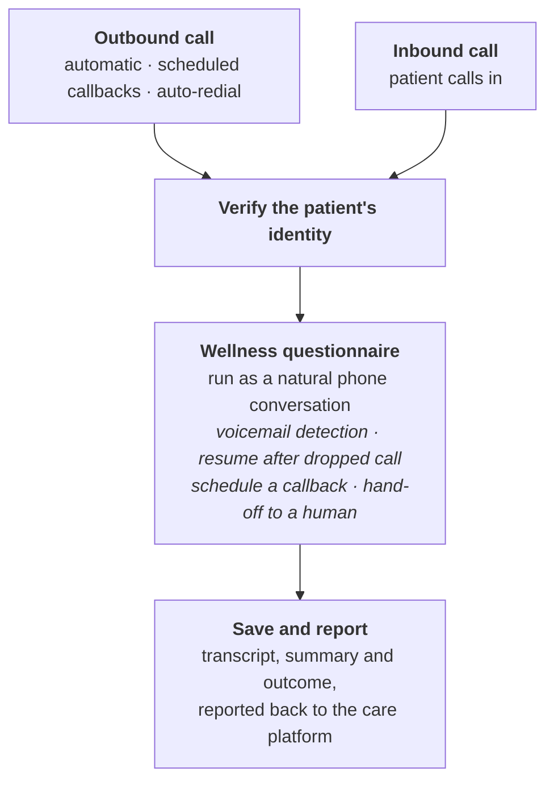

# CCM Outreach Agent

> Voice AI for chronic-care-management (CCM) patient outreach — handles both **outbound and inbound** calls.

> **Note:** this repository contains documentation only — an overview and the workflow of the project. Source code and data are not included.

## Overview

A voice agent that calls patients enrolled in chronic care management — and answers their calls — verifies who they are, and walks them through their monthly wellness questionnaire as a natural phone conversation.

## Workflow

## Capabilities

- **Outbound calls** — placed automatically, including scheduled callbacks and auto-redial after a dropped call.
- **Inbound calls** — patients can call in and are verified before the questionnaire starts.
- **Identity verification** before any questions are asked.
- **Natural conversation** — the monthly wellness questionnaire is asked conversationally.
- **Voicemail detection**, **resume after a dropped call**, **callback scheduling** and **hand-off to a human**.
- **Record keeping** — transcript, summary and outcome are saved and reported back to the care platform.

## Stack

Python · LiveKit · SIP telephony · LLM · Flask console · Docker

---

More projects: [github.com/ALIKAZMI001](https://github.com/ALIKAZMI001)
